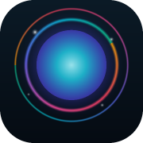

# Nebula Spectrum



An aurora-canvas theme for the DeepSeek Harness Web UI: four dark editions and
four light ones, each keeping its own spectrum at the window edges. Ported from
the PI-Desktop plugin of the same name, edition for edition.

English | [中文](#中文)

## Editions

| Edition | Scheme | Look |
| --- | --- | --- |
| 光谱·青蓝 · Indigo | dark | `#071320` canvas under six aurora lobes, glass sidebar, cyan accent (`#22d3ee`) |
| 光谱·余烬 · Ember | dark | ash and ember over a `#0a0605` canvas, warm orange accent |
| 光谱·朱红 · Crimson | dark | black canvas with a red-black glass sidebar, `#ef4444` accent |
| 光谱·霓虹 · Neon | dark | near-black canvas, cyan-to-violet neon rim |
| 光谱·彩虹 · Rainbow | light | white sheet, `#fcfbfd` chrome with a diagonal spectrum wash, magenta accent (`#be185d`) |
| 光谱·暖阳 · Sunrise | light | cream sheet under amber and rose light, `#b45309` accent |
| 光谱·冰蓝 · Glacier | light | cool white sheet, ice-blue accent (`#0369a1`) |
| 光谱·玫瑰 · Rose | light | porcelain sheet, rose accent (`#be185d`) |
| Follow appearance | — | Indigo when DSH is dark, Rainbow when it is light |

Every edition draws a spectrum hairline across the top of the window, a
two-layer spectrum rim around the composer (brighter while it has focus), a
gradient send button, a raised user bubble and a deep code well with a spectrum
banner band.

## What it paints

- **Canvas** — the app frame is made transparent so the body aurora shows
  through, in the same six-lobe layout the PI theme used.
- **Sidebar** — tinted glass with three colour lobes and a hairline on the
  divider.
- **Composer** — spectrum rim drawn with `padding-box`/`border-box` layers, so
  the border is the gradient itself.
- **Messages** — user bubbles become raised blocks ringed in the accent.
- **Code** — `.md-code-block` gets the edition's well colour plus a spectrum
  band behind the banner.
- **Window caption** — in the desktop app the native min/max/close band is
  repainted through the preload's appearance bridge; the band colour and the
  glyph ink come from the edition's `--dsw-specific-sidebar-fill` and
  `--dsw-alias-label-primary`.

## Install

Install it as a bundle from this folder, or from the prebuilt tarball attached
to the [latest release](https://github.com/LiuHongXuMaritime/dsh-nebula-spectrum/releases/latest),
with the app's plugin manager. The bundle patch registers one row,
`nebula-spectrum`: no host file is patched and nothing is written to the profile
by hand. Reload the page (or restart the app) after installing.

`package.json` declares both halves the manifest needs:

```jsonc
"dsh": {
  "bundle": { "patch": "./cordis.patch.yml" },
  "client": { "platform": "web", "immediately": true }
}
```

## Settings

Settings → General → **Nebula Spectrum** picks the edition: a "Follow appearance"
cube, then the four dark editions and the four light ones. The choice is stored
in `localStorage["dsh.nebula-spectrum.v1"]` and reflected as
`data-nebula-edition` (palette) and `data-nebula-scheme` (native control colour
scheme) attributes on the document element.

The plugin deliberately does not call `ctx.theme.register` or
`ctx.theme.overrideTokens`: the built-in Appearance row keeps full authority
over light, dark and system, and "Follow appearance" tracks it.

## How it works

Inside `html[data-nebula-edition="…"] body` blocks, `src/skin.css` re-points the
DSH design tokens (`--dsw-alias-*`, `--dsw-specific-*`, and the neutral/accent
`--dsw-static-*` ramps the client uses for inline styles) and styles surfaces
through stable hooks: token names, CSS-module class suffixes such as
`[class$="_sidebarCol"]` and `[class$="_composerSeat"]`, the two class names the
layout package hard-codes (`mP3x-q_frame`, `wtg9ga_root`), and `.md-code-block`.
The stylesheet is mounted into `<head>` so its rules land after the host sheet,
and every custom property carries `!important` because the host writes its own
tokens as inline styles on `<body>`.

## Build

`client.js` is generated. Edit `src/skin.css` for the palette and surface rules,
`src/client.template.js` for the mounting and the settings row, then:

```sh
node build.js
npm run icon   # or: node scripts/make-icon.mjs
```

The two original editions are mapped by hand in `src/skin.css`; the other six are
derived from the PI release by a script, so a new PI palette is one command away:

```sh
node scripts/sync-pi.mjs "path/to/local.nebula-spectrum-0.9.0.piplug"
```

| Path | What it is |
| --- | --- |
| `src/skin.css` | Scaffolding, surface rules and the two hand-mapped editions |
| `src/editions.generated.css` | The other six editions, written by `scripts/sync-pi.mjs` |
| `src/editions.json` | Edition metadata (ids, labels, scheme, preview swatch) |
| `src/client.template.js` | Client entry: edition store, picker row, `<head>` mount |
| `scripts/sync-pi.mjs` | Imports an edition set from a PI plugin package |
| `build.js` | Concatenates the editions, inlines everything, arms every property |
| `verify.js` | Parses `client.js` and prints build facts |
| `scripts/make-icon.mjs` | Renders `assets/icon-180.png` without any image library |
| `index.js` | Host half, intentionally empty |
| `docs/DETAIL.md` | The plugin's detail page |

## Notes

- Verified against DeepSeek Harness 0.2.2-rc.3 / desktop 0.2.2-rc.5 on Windows.
  Class hooks are the readable half of the CSS-module names; a host release that
  renames them needs a matching update here.
- Each edition pins its own colour scheme, so a dark edition stays dark even
  when the built-in appearance row says light.
- The caption-band repaint only exists in the desktop app. In a plain browser
  those buttons belong to the browser and stay untouched.
- `docs/DETAIL.md` is the detail page shown by the plugin manager.

## 中文

一个给 DeepSeek Harness Web 界面用的极光画布主题，含八套版本——深色四套
（青蓝、余烬、朱红、霓虹）与浅色四套（彩虹、暖阳、冰蓝、玫瑰），窗口边缘始终
保留各自的光谱。由同名 PI-Desktop 插件的 0.9.0 版本移植而来。

- **配色**：深色版本用各自的冷暖强调色，浅色版本分别用琥珀、天蓝、洋红等强调色。
- **画面**：画布极光、玻璃侧边栏、光谱描边的输入框、渐变发送按钮、抬起的用户气泡、
  带光谱条带的代码块，以及桌面端窗口右上角按钮的同步换色。
- **切换**：设置 → 通用 → 星云光谱，可选八套版本或跟随外观；选择存在
  `localStorage["dsh.nebula-spectrum.v1"]`。
- **安装**：在插件管理器里从本目录或最新 Release 的 tarball 安装，装完刷新页面。
- **实现**：不调用 `ctx.theme.register` / `ctx.theme.overrideTokens`，而是在
  `data-nebula-edition` 作用域内重设 DSH 设计令牌，并配合类名钩子给各界面元素上色。
- **同步**：`node scripts/sync-pi.mjs <piplug>` 可从 PI 插件包重新导入版本集合。

## License

MIT. The palette and surface design come from the original Nebula Spectrum
PI-Desktop theme by the same author.
